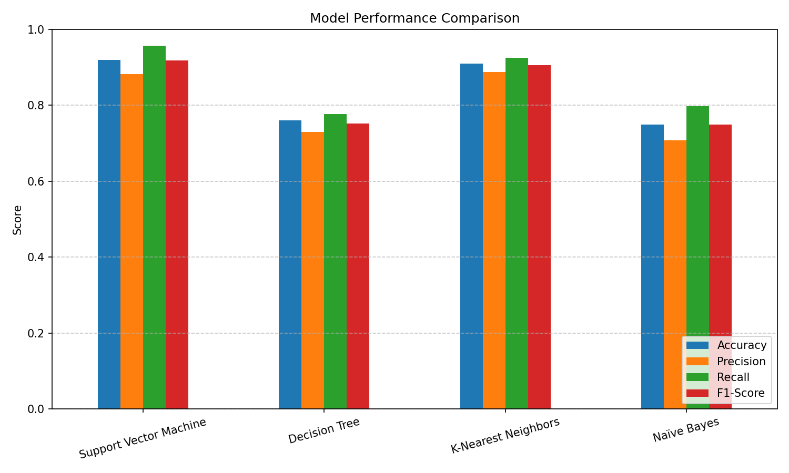

# Practical 5 – Classification Models Implementation & Comparative Analysis

**Student:** Arjun Pawashe | **PRN:** 202401100112 | **Division:** B | **Batch:** AIML-4 | **Roll No.:** 29
**Course:** TY B.Tech. – Artificial Intelligence and Machine Learning

## Aim
Implement four classification algorithms – **Support Vector Machine (SVM)**, **Decision Tree**,
**K-Nearest Neighbors (KNN)** and **Naïve Bayes** – and compare them using **Accuracy, Precision,
Recall, F1-Score and Log Loss**.

## Dataset
Synthetic binary classification data generated with `sklearn.datasets.make_classification`
(1000 samples, 10 features: 8 informative + 2 redundant, `random_state=42`).
No external dataset file is required. Split: 80% train / 20% test (`random_state=42`).
Features are standardised with `StandardScaler` for SVM, KNN and Naïve Bayes
(the Decision Tree uses unscaled data because it is scale-invariant).

## Models and hyper-parameters
| Model | Configuration |
|---|---|
| SVM | `SVC(kernel='rbf', C=1.0, probability=True)` |
| Decision Tree | `DecisionTreeClassifier(max_depth=5)` |
| KNN | `KNeighborsClassifier(n_neighbors=5)` |
| Naïve Bayes | `GaussianNB()` |

## Results (test set, 200 samples)
| Model | Accuracy | Precision | Recall | F1-Score | Log Loss |
|---|---|---|---|---|---|
| Support Vector Machine | 0.9200 | 0.8824 | 0.9574 | 0.9184 | 0.2275 |
| Decision Tree | 0.7600 | 0.7300 | 0.7766 | 0.7526 | 1.2307 |
| K-Nearest Neighbors | 0.9100 | 0.8878 | 0.9255 | 0.9062 | 0.5622 |
| Naïve Bayes | 0.7500 | 0.7075 | 0.7979 | 0.7500 | 0.5142 |

SVM gives the best accuracy, recall, F1-score and log loss; KNN is a close second and has the highest precision.
Decision Tree and Naïve Bayes perform noticeably worse on this dataset.



## Repository contents
| File | Description |
|---|---|
| `classification_models_comparison.ipynb` | Jupyter notebook with code and outputs |
| `classification_models.py` | Same implementation as a runnable script |
| `requirements.txt` | Python dependencies |
| `sample_output.txt` | Console output of the script |
| `results.csv` | Metrics table of all four models |
| `model_comparison.png` | Bar chart of Accuracy / Precision / Recall / F1 |

## How to run
```bash
pip install -r requirements.txt
python classification_models.py          # prints metrics, writes results.csv and model_comparison.png
# or open classification_models_comparison.ipynb in Jupyter / Google Colab and run all cells
```
