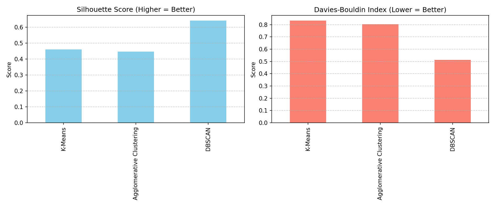

# Practical 6 – Clustering Algorithms Implementation & Performance Evaluation

**Student:** Arjun Pawashe | **PRN:** 202401100112 | **Division:** B | **Batch:** AIML-4 | **Roll No.:** 29
**Course:** TY B.Tech. – Artificial Intelligence and Machine Learning

## Aim
Implement **K-Means**, **Agglomerative (hierarchical) clustering** and **DBSCAN** on the Iris dataset and evaluate them
with the **Silhouette Score, Davies-Bouldin Index and Calinski-Harabasz Index**, with 2-D PCA visualisations.

## Dataset
Iris dataset (`sklearn.datasets.load_iris`) – 150 samples, 4 features (sepal/petal length and width).
It is bundled with scikit-learn, so no external file is needed. Species labels are **not** used for clustering.
Features are standardised with `StandardScaler`; PCA (2 components, ~95.8% of variance) is used only for plotting.

## Models and parameters
| Model | Configuration |
|---|---|
| K-Means | `KMeans(n_clusters=3, n_init=10, random_state=42)` |
| Agglomerative | `AgglomerativeClustering(n_clusters=3, linkage='ward')` |
| DBSCAN | `DBSCAN(eps=0.6, min_samples=5)` |

## Results
| Model | Clusters | Noise points | Silhouette ↑ | Davies-Bouldin ↓ | Calinski-Harabasz ↑ |
|---|---|---|---|---|---|
| K-Means | 3 | 0 | 0.4599 | 0.8336 | 241.9044 |
| Agglomerative | 3 | 0 | 0.4467 | 0.8035 | 222.7192 |
| DBSCAN | 2 | 26 | 0.6419 | 0.5121 | 330.9165 |

**Note:** DBSCAN's metrics are computed after excluding its 26 noise points (of 150) and for only 2 clusters,
so they are not directly comparable with the 3-cluster results of K-Means and Agglomerative clustering.



## Repository contents
| File | Description |
|---|---|
| `clustering_algorithms_comparison.ipynb` | Jupyter notebook with code and outputs |
| `clustering_algorithms.py` | Same implementation as a runnable script |
| `requirements.txt` | Python dependencies |
| `sample_output.txt` | Console output of the script |
| `results.csv` | Metrics table |
| `kmeans_clusters.png`, `agglomerative_clusters.png`, `dbscan_clusters.png` | PCA cluster plots |
| `metrics_comparison.png` | Silhouette and Davies-Bouldin bar charts |

## How to run
```bash
pip install -r requirements.txt
python clustering_algorithms.py     # prints metrics, writes results.csv and the PNG plots
# or open clustering_algorithms_comparison.ipynb in Jupyter / Google Colab and run all cells
```
